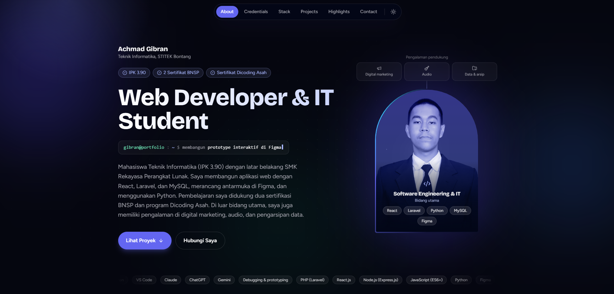

<div align="center">

# Portfolio & Digital Workspace

**Achmad Gibran** — Web Developer & IT Student at STITEK Bontang  
*Elegance in Engineering, Precision in Design.*

<br>



<br>

[](https://next.js.org/)
[](https://react.dev/)
[](https://tailwindcss.com/)
[](https://github.com/AchmadGibran/personal-notes-app)

</div>

---

## ⚡ Arsitektur & Filosofi Desain

Repositori ini adalah rumah bagi portofolio profesional pribadi yang dirancang dengan standar performa dan estetika tinggi. Menggunakan arsitektur modern berbasis **Next.js 14 App Router**, situs ini memisahkan secara ketat antara logika server dan interaktivitas klien (`"use client"`), memastikan pemuatan halaman yang instan (*blazing fast*) serta SEO yang optimal.

### Karakteristik Utama:
* **Immersive Aesthetics:** Mengusung tema *dark mode* elegan dengan sentuhan efek *Aurora background*, kursor interaktif (*Cursor Aura*), dan transisi tema melingkar yang halus tanpa mengorbankan aksesibilitas (`prefers-reduced-motion` didukung penuh).
* **Modular Data-Driven:** Seluruh konten (mulai dari profil, kredensial, *tech stack*, hingga proyek) terisolasi rapi di dalam direktori `src/data/`, memudahkan pemeliharaan konten tanpa menyentuh komponen UI.
* **Interactive Showcase:** Menampilkan filter proyek interaktif yang membedakan secara jelas antara *Web Development/Backend* dan *UI/UX & Prototype*.

---

## 📂 Struktur Direktori Proyek

```text
src/
├── app/
│   ├── layout.jsx        # Root layout, metadata, font, dan provider tema
│   ├── page.jsx          # Titik perakitan utama seluruh section portofolio
│   └── globals.css       # Konfigurasi Tailwind CSS dan custom keyframes animation
├── data/                 # Pusat basis data statis (mudah disesuaikan)
│   ├── profile.js        # Informasi identitas, bio, dan tone foto
│   ├── navigation.js     # Navigasi utama
│   ├── credentials.js    # Sertifikasi & penghargaan nasional
│   ├── stack.js          # Daftar keahlian teknologi
│   ├── projects.js       # Showcase proyek coding & UI/UX
│   ├── highlights.js     # Pencapaian & sorotan karier
│   └── socials.js        # Tautan media sosial
├── sections/             # Blok modular halaman (Hero, Education, TechStack, Projects, dll)
├── components/
│   ├── TShape.jsx        # Komponen potret interaktif dengan bingkai artistik
│   ├── layout/           # Floating navigation & Footer
│   └── ui/               # Koleksi komponen atomik (Glow, Reveal, Typewriter, Lightbox, dll)
└── lib/
    └── theme.js          # Utilitas manajemen tema terang/gelap